# Báo cáo EDA và tiền xử lý GTSRB

**Phạm vi:** Thành viên 1 — khám phá dữ liệu, giải thích quyết định tiền xử lý và
bàn giao cho phần đặc trưng/mô hình/đánh giá. Bổ sung diễn giải ngày **2026-11-12**;
số liệu và hình lấy từ hai notebook đã thực thi ngày **2026-11-11**, không phải
một lượt huấn luyện mới. Đây là báo cáo Markdown, chưa phải chương LaTeX hoặc
kết quả mô hình cuối cùng.

## Tóm tắt

Dữ liệu gồm **39.209 ảnh train, 12.630 ảnh test và 43 lớp**. EDA cho thấy mất cân
bằng lớp, nhiều khung hình cùng track, ảnh nhỏ, biến thiên ánh sáng và các lớp
có hình thức gần nhau. Vì vậy, pipeline giữ cách chia chính thức, crop ROI,
resize về 32×32, giữ RGB và chia 255; không tự loại mẫu khó hoặc học thống kê từ
test. Ablation cung cấp bằng chứng thăm dò cho ROI và RGB, nhưng không chứng minh
cấu hình đã tối ưu. Đặc biệt, **giữ tất cả ảnh biển trái/phải cùng nhãn gốc,
không lật ảnh và không gộp hai hướng thành một lớp**.

Báo cáo phân biệt ba loại thông tin: **đã đo** (CSV/JSON/đầu ra notebook),
**diễn giải hoặc giả thuyết** (cần kiểm chứng thêm), và **quy tắc bảo toàn nhãn**
(như không lật biển chỉ hướng). Mỗi biểu đồ được đặt cạnh phần giải thích,
không dùng hình thay cho kết luận.

**Mục lục:**
- [1. Bài toán, nguồn và giả định](#1-bài-toán-nguồn-và-giả-định)
- [2. Phân tích dữ liệu và ba giả thuyết](#2-phân-tích-dữ-liệu-eda)
- [3. Tiền xử lý và các trường hợp đặc biệt](#3-tiền-xử-lý-và-cách-chia-dữ-liệu)
- [4. Ablation: kết quả, giải thích và giới hạn](#4-minh-chứng-tác-động-ablation-tiền-xử-lý)
- [5. Tái lập và bằng chứng kiểm tra](#5-tái-lập-log-và-minh-bạch-ai)
- [6. Kết luận bàn giao và việc cần làm tiếp](#6-kết-luận-bàn-giao-và-việc-cần-làm-tiếp)

## 1. Bài toán, nguồn và giả định

- Phân loại một ảnh biển đã định vị thành một trong **43 ClassId (0–42)**.
  Không giải bài toán phát hiện biển trong toàn cảnh đường phố.
- GTSRB (German Traffic Sign Recognition Benchmark), Institut für Neuroinformatik,
  Ruhr-Universität Bochum, benchmark tại IJCNN 2011. Tham khảo Stallkamp và cộng sự,
  *The German Traffic Sign Recognition Benchmark: A multi-class classification
  competition*, [DOI](https://doi.org/10.1109/IJCNN.2011.6033395).
- [Trang gốc](https://benchmark.ini.rub.de/gtsrb_dataset.html);
  [bản PNG/CSV trên Kaggle để tham khảo tải](https://www.kaggle.com/datasets/meowmeowmeowmeowmeow/gtsrb-german-traffic-sign).
  Repo yêu cầu bố cục `data/archive/Train.csv`, `Test.csv`, `Meta.csv`, các thư mục
  `Train/`, `Test/`, `Meta/`. Bản gốc PPM không đọc trực tiếp bằng pipeline này.
  Không có hồ sơ để xác nhận nguồn tải của bản local.
- **Giấy phép: cần xác minh.** Bản local không có README/LICENSE. Lần kiểm tra
  2026-11-11 chưa truy cập được trang gốc và nội dung Kaggle không đủ xác nhận
  điều khoản. Thành viên cần kiểm tra đúng trang tải trước khi sử dụng/tái phân
  phối. Không gán giấy phép dựa trên việc dữ liệu được công khai.
- Giả định mỗi ảnh có một biển, ROI/nhãn đúng. Chỉ biển Đức, chưa chứng minh tổng
  quát sang biển Việt Nam. Đây là nghiên cứu phân loại, không phải hệ thống an
  toàn đủ điều kiện triển khai trên xe tự lái.

## 2. Phân tích dữ liệu (EDA)

Nguồn chi tiết: [01_eda.ipynb](../notebooks/01_eda.ipynb),
[eda_summary.json](eda_summary.json), [bảng EDA](tables/) và [hình](figures/).

**Phạm vi từng phép đo:**

| Nội dung | Dữ liệu được dùng | Điều không được suy rộng |
|---|---|---|
| Toàn vẹn, nhãn, kích thước và ROI | Toàn bộ các CSV; kiểm tra sự tồn tại của Path | Kích thước ở đây lấy từ metadata, không phải đối chiếu lại mọi kích thước ảnh giải mã; Path khác nhau chưa chứng minh nội dung khác nhau |
| Số kênh và dtype gốc | 500 ảnh lấy mẫu từ train/test | Không đại diện cho kiểm định định dạng của mọi ảnh gốc |
| Độ sáng, tương phản | 2.000 train phân tầng, seed 42; đo grayscale trên ảnh gốc | Cực trị trong mẫu không phải cực trị toàn bộ dataset |
| Mean R/G/B theo nhóm màu | ROI của cùng mẫu chất lượng | Không đồng nhất với phép đo độ sáng toàn ảnh; nhóm màu không thay nhãn ClassId |
| Lưới 43 lớp | 1 ảnh Meta và 5 ảnh train mỗi lớp | Meta là mẫu tham chiếu, không thêm vào train |
| Mean images | Toàn bộ ảnh train đã tiền xử lý của 8 lớp tốc độ | Ảnh trung bình không phải một mẫu thật hoặc confusion matrix |
| KNN thăm dò màu | 5.000 train / 2.000 test phân tầng | Không phải huấn luyện và đánh giá cuối trên toàn bộ tập |
| Ablation tiền xử lý | 8.000 train phân tầng / 3.000 test ngẫu nhiên, cùng mẫu cho 6 phương án | Không so trực tiếp với điểm của thí nghiệm 5.000/2.000 |

### 2.1. Quy mô, tính toàn vẹn và mất cân bằng

- **39.209 train, 12.630 test, 43 lớp**, cùng 43 ảnh Meta chuẩn.
- Train/Test không có NaN, dòng trùng, Path trùng hay Path thiếu. Meta có 1 NaN
  ở `SignId` của ClassId 30; không ảnh hưởng ClassId/ColorId/ShapeId, không tự
  suy đoán hay loại bỏ lớp.
- Train có **1.307 track**, trung vị 30 ảnh/track: 1.306 track đủ 30 ảnh và
  `00033_00019` có 29 ảnh. Không tự thêm ảnh để đổi tổng thành 39.210.
- Train: **210–2.250 ảnh/lớp**, tỉ lệ max/min **10,71 lần**. Lớp ít nhất:
  0, 19, 37; lớp nhiều nhất: 2. Test: 60–750 ảnh/lớp, tỉ lệ **12,5 lần**.
- Accuracy chịu ảnh hưởng của lớp phổ biến. Báo cáo thêm Macro-F1 (mỗi lớp có
  trọng số ngang nhau), rồi kiểm tra recall/confusion từng lớp ở bước đánh giá.

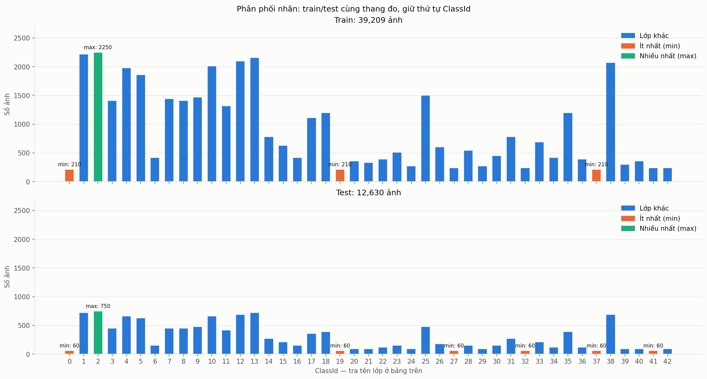

**Diễn giải:** số mẫu chênh lệch hơn 10 lần làm số quan sát huấn luyện mỗi lớp
không tương đương. Không được suy ra lớp hiếm chắc chắn có recall thấp nếu chưa
đối chiếu dự đoán. Macro-F1 cho mỗi lớp trọng số ngang nhau nên cần báo cáo cùng
Accuracy; chênh lệch giữa hai chỉ số tự nó không chứng minh nguyên nhân là mất
cân bằng. Không cân bằng lại test vì sẽ thay bài toán đánh giá chính thức.

Các khung trong một track ghi lại cùng biển nên không nên coi là các quan sát
hoàn toàn độc lập. Chia train/validation theo từng ảnh có nguy cơ đưa các khung
gần giống vào hai phía. **CV theo track là đề xuất cho bước sau, chưa được chạy
trong EDA này**; kiểm tra Path không giao nhau cũng chưa loại trừ trùng nội dung.

Nguồn: [đếm nhãn](tables/eda_label_counts.csv),
[thống kê lớp](tables/eda_label_statistics.csv),
[tính toàn vẹn](tables/eda_integrity.csv).

### 2.2. Kích thước, màu và chất lượng

- Trung vị **43×43** cho cả train/test. Train: Width 25–243, Height 25–225;
  test: Width 25–266, Height 25–232 pixel.
- Cả hai chiều dưới 32: **4.766 train / 1.632 test**. Ít nhất một chiều dưới 32:
  **6.505 train / 2.292 test**. Hai định nghĩa không được đánh đồng.
- Mẫu 500 ảnh: 500 ảnh có 3 kênh uint8; đây là kiểm tra mẫu, không phải kết luận
  đã kiểm định mọi định dạng gốc.
- Mẫu 2.000 train: độ sáng grayscale trung bình **0,3182**, trung vị **0,2906**,
  phạm vi **0,0341–0,9539**. Tương phản trung vị **0,1594**, nhỏ nhất **0,0099**.
- ROI/toàn ảnh trung vị **60,34% train / 60,06% test**. Chia 255 chỉ đổi thang,
  không sửa mờ, phơi sáng hay tương phản.
- Các lớp giới hạn tốc độ có hình dáng/viền giống nhau và chữ số nhỏ. Mean image
  là gợi ý các lớp khó phân biệt, không phải bằng chứng confusion matrix.

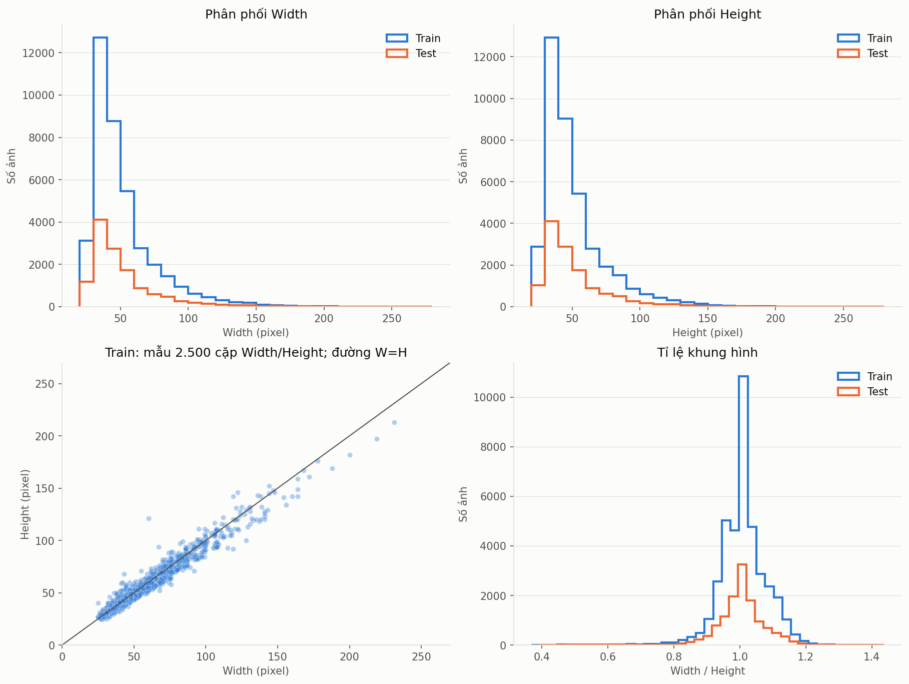

**Diễn giải kích thước:** nhiều ảnh nằm gần đường W=H, nhưng không phải tất cả
đều vuông (W/H train khoảng 0,368–1,418). Biểu đồ phân tán dùng 2.500 ảnh train,
còn histogram và thống kê lấy toàn CSV. Trục số lượng của train cao hơn một
phần do train có nhiều ảnh hơn test; không coi chiều cao khác nhau là bằng chứng
đổi phân phối. Resize tạo kích thước đầu vào chung cho Pixel/HOG nhưng có thể
kéo méo tỉ lệ. Ảnh nhỏ phải phóng to, đặc biệt ROI sau crop có thể nhỏ hơn ảnh
gốc; phóng to không phục hồi chi tiết đã mất. Chưa đánh giá phương án padding
bảo toàn tỉ lệ nên không tuyên bố resize vuông là tối ưu.

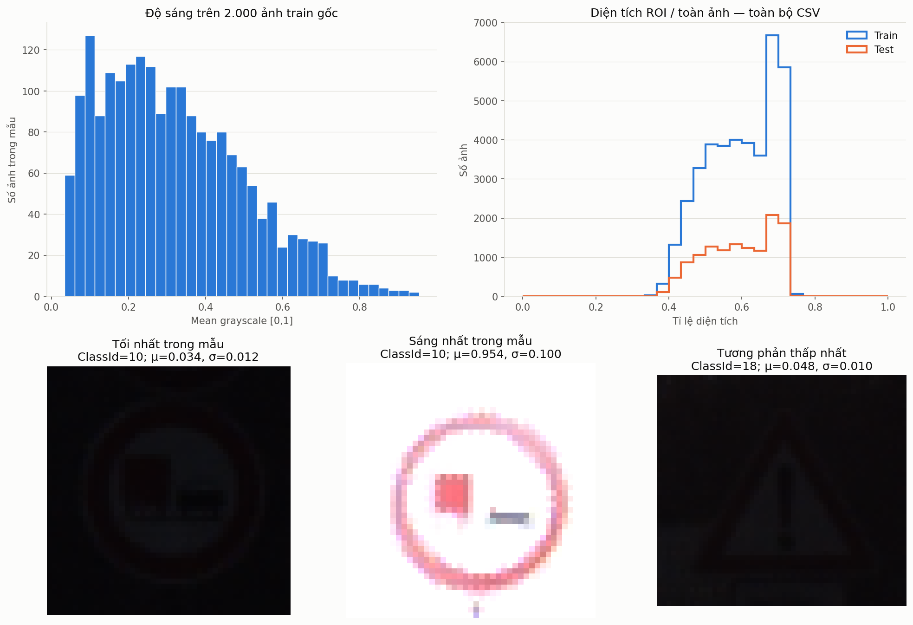

**Đo sáng và tương phản:** độ sáng là trung bình grayscale/255; tương phản là
độ lệch chuẩn grayscale/255. Ba ví dụ dưới đây đều thuộc mẫu 2.000 train, không
phải các ảnh cực trị đã được xác định trên toàn bộ tập:

| Trường hợp | Path trong dữ liệu | ClassId | Độ sáng | Tương phản |
|---|---|---:|---:|---:|
| Tối nhất trong mẫu | `Train/10/00010_00053_00012.png` | 10 | 0,0341 | 0,0116 |
| Sáng nhất trong mẫu | `Train/10/00010_00003_00024.png` | 10 | 0,9539 | 0,0999 |
| Tương phản thấp nhất trong mẫu | `Train/18/00018_00033_00009.png` | 18 | 0,0484 | 0,0099 |

Ảnh tối làm biểu tượng khó nhìn, ảnh sáng nhất có màu nhạt và nền gần trắng.
Đây là quan sát phù hợp nguy cơ thiếu/thừa sáng, không phải nhãn phơi sáng do
chuyên gia xác nhận. **Chưa đo độ mờ hoặc thống kê tỉ lệ ảnh mờ**; không chuyển
nhận xét trực quan thành số liệu. Giữ các mẫu khó thay vì loại để nâng điểm.

**Diễn giải ROI:** vùng crop thường chiếm khoảng 60% diện tích ảnh theo trung vị,
gợi ý nền ngoài ROI có thể ảnh hưởng khoảng cách pixel. ROI vẫn có thể chứa nền;
60% không phải độ chính xác định vị hoặc tỉ lệ ảnh có biển. Histogram ROI dùng
số lượng tuyệt đối nên không dùng riêng chiều cao cột để kết luận train/test
khác phân phối. Tác động tới phân loại được đối chiếu bằng ablation ở mục 4.

Nguồn: [kích thước](tables/eda_size_statistics.csv),
[kích thước theo lớp](tables/eda_size_by_class.csv),
[mẫu kênh màu](tables/eda_channel_sample.csv),
[mẫu chất lượng](tables/eda_quality_sample.csv),
[thống kê ROI](tables/eda_roi_statistics.csv).

### 2.3. Thông tin màu và thăm dò RGB/grayscale

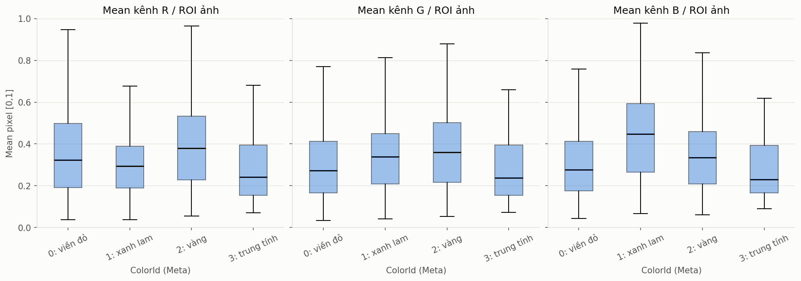

**Diễn giải:** các nhóm màu có phân phối kênh khác nhau; nhóm biển xanh có xu
hướng mean B cao hơn R/G. Màu có thể giúp tách nhóm biển nhưng các phân phối còn
chồng lấn, chịu ảnh hưởng ánh sáng và nền trong ROI. `ColorId`/`ShapeId` trong
Meta là nhóm tham chiếu, không thay `ClassId` và không đủ xác định riêng một
trong 43 lớp. Boxplot này không vẽ điểm ngoại lai; điều đó không có nghĩa dữ
liệu không có ngoại lai. Bảng nguồn: [nhóm màu/hình](tables/eda_color_shape.csv),
[thống kê RGB](tables/eda_color_statistics.csv).

KNN k=3 trên 5.000 train / 2.000 test **đều lấy mẫu phân tầng**, seed 42:

| Biểu diễn | Số chiều | Accuracy | Macro-F1 |
|---|---:|---:|---:|
| RGB | 3.072 | 42,95% | 36,91% |
| Grayscale | 1.024 | 40,35% | 34,38% |

RGB hơn 2,60 đpt Accuracy và 2,53 đpt Macro-F1. Kết quả ủng hộ giữ thông tin màu
trong thăm dò này, không chứng minh RGB luôn tốt hơn cho mọi mô hình. Hai cách
biểu diễn dùng cùng mẫu và KNN cố định; thay RGB bằng grayscale đồng thời đổi số
chiều và hình học khoảng cách, nên không tách riêng hoàn toàn tác động của màu.
Nguồn: [so sánh KNN](tables/eda_knn_color_comparison.csv),
[manifest 7.000 mẫu](tables/eda_knn_sample_manifest.csv).

### 2.4. Quan sát đủ 43 lớp và các lớp dễ nhầm về hình thức

Ba lưới dưới đây bao phủ đủ ClassId 0–42. Mỗi lớp có một ảnh Meta tham chiếu và
năm ảnh train; tổng cộng **43 ảnh Meta + 215 ảnh train**. Chúng giúp xem đồng
thời biến thiên trong một lớp và khác biệt giữa các lớp, không đại diện cho mọi
điều kiện chụp. Danh sách ảnh: [manifest mẫu](tables/eda_samples_manifest.csv).

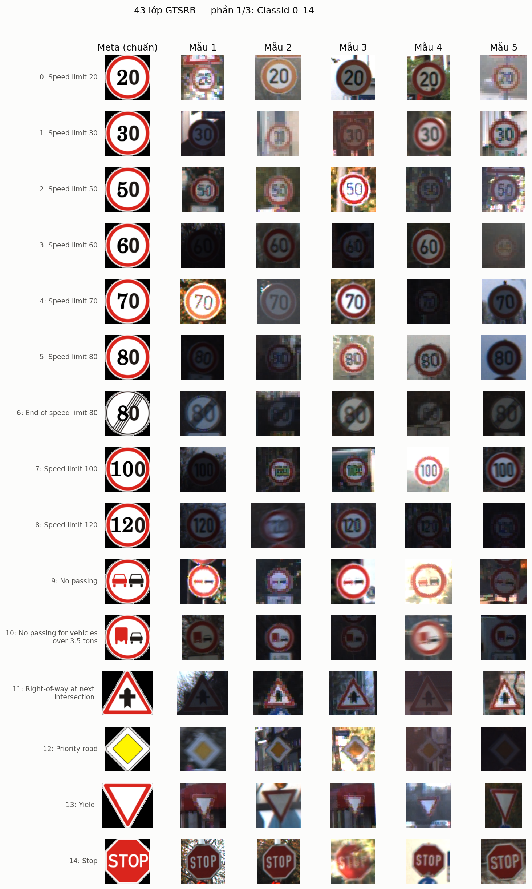

*Nhóm 0–14:* nhiều biển giới hạn tốc độ có cùng hình tròn/viền đỏ, chỉ khác chữ
số; màu/hình dạng chung không đủ phân biệt. Một số biển có hình dạng riêng như
Stop hoặc Yield cung cấp thêm dấu hiệu hình học, nhưng chưa có kết quả cho thấy
những lớp đó chắc chắn dễ hơn đối với mô hình đang xét.

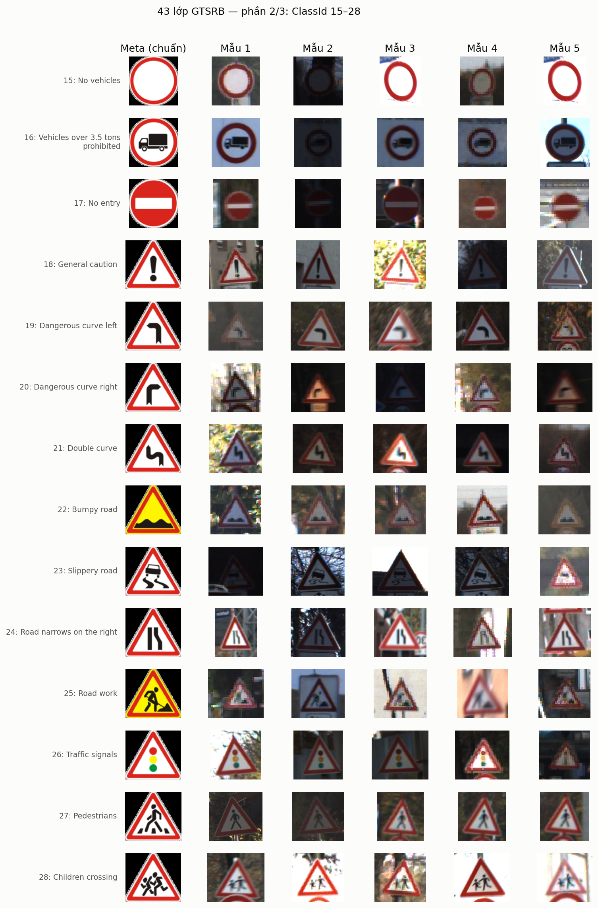

*Nhóm 15–28:* các biển cấm và cảnh báo có thể cùng khung hình nhưng khác biểu
tượng bên trong. Cặp cảnh báo cong trái/phải (19/20) cũng phụ thuộc hướng; không
chỉ các mũi tên trên nền xanh mới cần tránh lật.

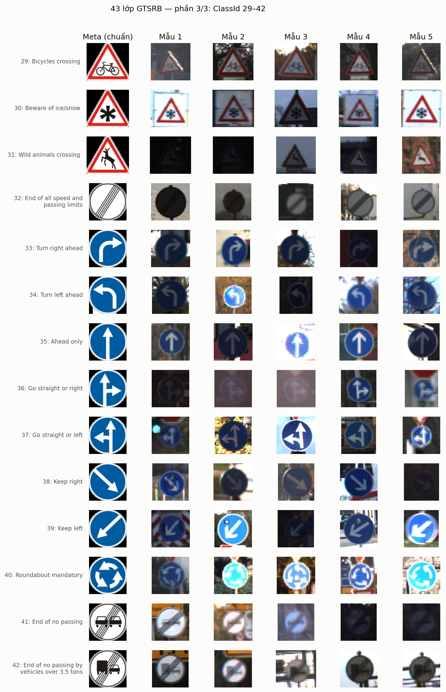

*Nhóm 29–42:* giữ khác biệt giữa rẽ trái/phải, đi thẳng hoặc rẽ, đi về phía
trái/phải và vòng xuyến. Các lớp 33/34, 36/37, 38/39 không được gộp chỉ vì có
cùng màu nền và gần đối xứng. Quy tắc bảo toàn hướng được giải thích tại mục 3.2.

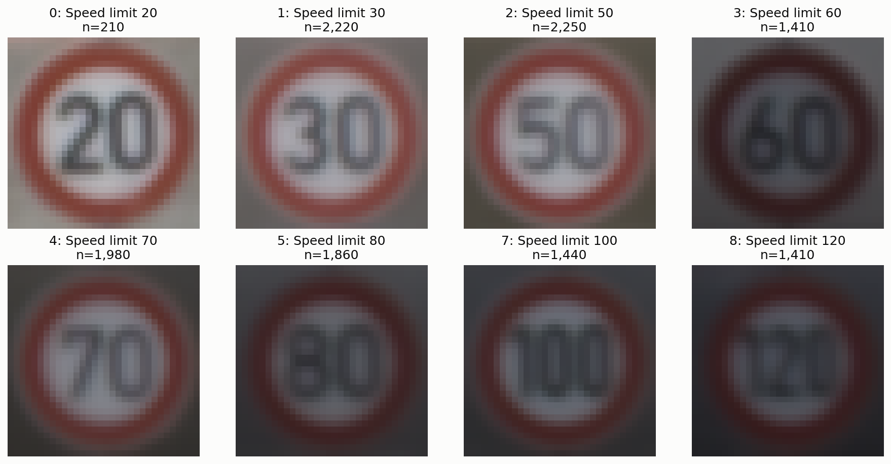

**Diễn giải mean images:** các lớp 0, 1, 2, 3, 4, 5, 7, 8 tương ứng giới hạn
20, 30, 50, 60, 70, 80, 100, 120. Trung bình ảnh làm rõ khung viền chung nhưng
có thể làm nhòe chữ số do khác vị trí/góc chụp. Đây là cơ sở đặt câu hỏi liệu
mô hình có nhầm các biển tốc độ khi ảnh ít chi tiết, **không phải bằng chứng đã
xảy ra nhầm lẫn**. Muốn kết luận phải dùng dự đoán và confusion matrix thật.

### 2.5. Ba giả thuyết nghiên cứu từ EDA

Ba phát biểu dưới đây được hệ thống hóa khi bổ sung báo cáo từ EDA và các kết
quả đã có, **không phải giả thuyết đăng ký trước thí nghiệm hay kiểm định thống
kê đã hoàn tất**. “Được ủng hộ trong thăm dò” không đồng nghĩa được chứng minh
cho mọi mô hình. Mỗi giả thuyết có cơ sở, dấu hiệu cần đo và cách kiểm chứng tiếp.

#### 2.5.1. Giả thuyết H1 — Giữ RGB có ích hơn grayscale cho KNN pixel

- **Phát biểu:** với cùng mẫu, ROI, kích thước và KNN k=3, biểu diễn RGB cho
  Accuracy và Macro-F1 cao hơn grayscale vì giữ thêm thông tin phân biệt nhóm
  biển theo màu.
- **Cơ sở EDA:** các nhóm ColorId có phân phối RGB khác nhau, nhưng chồng lấn;
  do đó cần phép so sánh mô hình chứ không kết luận chỉ từ boxplot.
- **Bằng chứng đã có:** ở thí nghiệm 5.000/2.000, RGB hơn **2,60 đpt Accuracy,
  2,53 đpt Macro-F1**. Ở ablation 8.000/3.000, mốc RGB hơn grayscale **2,20 đpt
  Accuracy, 1,21 đpt Macro-F1**. Đây là hai so sánh trong từng mẫu riêng, không
  dùng chênh lệch giữa hai thí nghiệm làm mức cải thiện và không coi là hai phép
  lặp độc lập đã được thiết kế để kiểm định.
- **Kết luận hiện tại:** **được ủng hộ ở mức thăm dò** cho KNN pixel; đủ lý do
  giữ RGB trong hợp đồng hiện tại. Chưa chứng minh màu là nguyên nhân duy nhất
  do số chiều thay đổi từ 3.072 xuống 1.024 khi chuyển grayscale.
- **Kiểm chứng tiếp:** so sánh ghép cặp trên cùng các fold theo track của train,
  báo cáo chênh lệch Macro-F1 cùng độ biến thiên, cố định các bước còn lại. Nếu
  lợi thế không ổn định hoặc đảo chiều, không khẳng định RGB tốt hơn trong thiết
  lập đó. Không tiếp tục dùng test con để chọn cách biểu diễn.

#### 2.5.2. Giả thuyết H2 — Lớp ít mẫu có nguy cơ được nhận dạng kém hơn

- **Phát biểu:** các lớp ít mẫu train có thể đạt recall/F1 thấp hơn trung bình;
  chỉ nhìn Accuracy toàn tập có thể bỏ sót vấn đề ở các lớp này.
- **Cơ sở EDA:** train mất cân bằng **10,71 lần**; ClassId 0, 19, 37 chỉ có 210
  ảnh mỗi lớp, so với 2.250 ảnh của ClassId 2. Số frame cũng không bằng số quan
  sát độc lập vì nhiều ảnh cùng track.
- **Bằng chứng đã có:** phân phối mẫu được xác nhận trên toàn CSV. Báo cáo hiện
  chưa đối chiếu recall/F1 của từng lớp với số mẫu hoặc số track. Việc Accuracy
  mốc ablation **47,67%** còn Macro-F1 **40,76%** chỉ là tín hiệu cần xem kỹ, không
  chứng minh lớp hiếm là nguyên nhân hoặc mọi lớp hiếm đều kém.
- **Kết luận hiện tại:** **chưa kiểm chứng tác động lên lỗi phân loại**. Mất cân
  bằng là sự kiện đã đo; quan hệ mất cân bằng → chất lượng từng lớp là giả thuyết.
- **Kiểm chứng tiếp:** tạo dự đoán ngoài fold bằng CV theo track trên train,
  báo cáo support, số track, recall và F1 từng lớp. Kiểm tra mối liên hệ với
  lượng mẫu, đồng thời xét độ giống hình và chất lượng ảnh. Nếu lớp hiếm vẫn
  nhận dạng tốt hoặc không thấy xu hướng nhất quán, phải thu hẹp/bác bỏ phát
  biểu trong thiết lập đó. Chưa tự oversample, gán trọng số hay cân bằng lại test.

#### 2.5.3. Giả thuyết H3 — Ảnh ít chi tiết làm tăng nguy cơ nhầm biển tốc độ

- **Phát biểu:** ảnh nhỏ, mờ về mặt trực quan, quá tối/sáng hoặc tương phản thấp
  có thể làm mất nét chữ số, tăng nguy cơ nhầm giữa các biển tốc độ có cùng
  hình tròn và viền đỏ.
- **Cơ sở EDA:** có 6.505 ảnh train với ít nhất một chiều dưới 32 theo metadata;
  trong mẫu chất lượng, độ sáng từ 0,0341 đến 0,9539 và tương phản thấp nhất
  0,0099. Lưới lớp và mean images cho thấy nhiều lớp tốc độ chỉ khác chữ số.
- **Bằng chứng đã có:** kích thước, sáng/tương phản và ví dụ ảnh đã được lưu.
  **Chưa đo blur, chưa chia dự đoán theo nhóm chất lượng và chưa có phân tích
  confusion cho các nhóm này.** Kết quả 48×48 không hơn mốc trong ablation chỉ
  cho thấy phóng ảnh chưa giúp KNN trên mẫu đó, không chứng minh H3.
- **Kết luận hiện tại:** **có cơ sở quan sát, chưa kiểm chứng bằng lỗi mô hình**.
  Không khẳng định cụ thể một cặp tốc độ là cặp bị nhầm nhiều nhất.
- **Kiểm chứng tiếp:** trên các dự đoán ngoài fold của train, định nghĩa trước
  nhóm kích thước/độ sáng/tương phản bằng train fold, báo cáo support và tỷ lệ
  lỗi theo nhóm; nếu xét blur thì bổ sung phép đo được mô tả rõ. Đối chiếu
  confusion giữa các lớp tốc độ, kiểm soát khác biệt lớp/track. Nếu nhóm ít
  chi tiết không có xu hướng lỗi cao hơn, cần điều chỉnh giả thuyết thay vì
  chọn lại ngưỡng cho khớp kết quả. Không loại ảnh khó khỏi test.

**Chốt ba giả thuyết:** H1 có bằng chứng định lượng thăm dò; H2 và H3 mới có cơ
sở EDA, chưa hoàn tất kiểm chứng. Quy tắc “không lật biển trái/phải” ở mục 3.2
là điều kiện giữ đúng nhãn, không được ghi như một giả thuyết tăng Accuracy đã đo.

## 3. Tiền xử lý và cách chia dữ liệu

### 3.1. Sơ đồ xử lý và hợp đồng dữ liệu

```text
Train.csv + Train/                         Test.csv + Test/
        |                                         |
        +---- xử lý riêng, giữ thứ tự và nhãn -----+
                             |
                  Kiểm tra CSV, Path, ClassId
                             |
                 Đọc ảnh và chuyển BGR -> RGB
                             |
             Crop ROI cận đóng, kẹp theo biên ảnh
             (ROI không hợp lệ: dùng toàn ảnh)
                             |
                  Resize 32 x 32, INTER_AREA
                             |
               Chuyển float32 và chia cho 255
                             |
              X_train, X_test; y_train, y_test
                    + danh sách 43 tên lớp
                             |
              Bàn giao cho trích xuất đặc trưng
```

Hai luồng không trộn mẫu; sơ đồ chỉ dùng chung các thao tác không học tham số.
Ảnh thiếu/hỏng hoặc Path/ClassId không hợp lệ làm dừng với thông báo lỗi, không
đi tiếp bằng cách bỏ mẫu. Cache hợp lệ cho phép nạp lại đầu ra đã xử lý.

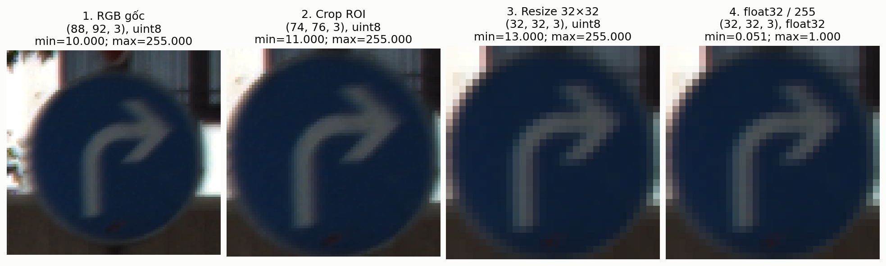

**Đọc hình:** một ảnh ClassId 33 vẫn giữ hướng mũi tên phải qua cả bốn bước.
Ở ví dụ này, ảnh từ `(88,92,3)` thành ROI `(74,76,3)`, rồi `(32,32,3)`; bước
cuối chỉ đổi dtype/thang giá trị. Resize không khôi phục nét mũi tên bị mờ.
Hình là minh họa một mẫu, không phải chứng minh chất lượng của mọi ảnh.

- NumPy slice loại cận phải nên crop dùng `y1:y2+1, x1:x2+1`; ROI không hợp lệ
  thì giữ toàn ảnh. Ảnh thiếu/hỏng làm dừng, không bỏ âm thầm để lệch nhãn.
- Đầu ra `load_and_preprocess(data_dir)` giữ đúng thứ tự:
  `X_train_img, X_test_img, y_train, y_test, class_names`.
- Ảnh RGB float32: train `(39209,32,32,3)`, test `(12630,32,32,3)`, trong [0,1].
  Nhãn int64 một chiều; 43 tên lớp, index bằng ClassId.
- Giữ toàn bộ hai CSV train/test chính thức; không chia lại ngẫu nhiên, không
  tạo validation. Thành viên mô hình cần CV theo **(ClassId, TrackId)** để không
  đưa các khung hình gần giống của cùng biển vào cả train/validation fold.
- Không học mean/std, StandardScaler hay PCA ở phần tiền xử lý. Những bước học
  thống kê do phần đặc trưng/mô hình fit đúng trên train, hoặc trên train fold
  khi cross-validation; không sửa các mô-đun đó trong công việc này.
- Augmentation mặc định tắt; minh họa chỉ xoay nhẹ ±10°, dịch ≤5%, sáng/tương
  phản ≤10%. **Cấm lật ngang/dọc** vì có thể đổi nghĩa lớp 33↔34, 38↔39.
- `load_image` có tùy chọn keyword-only `image_size`/`interpolation` để chạy
  ablation; bỏ tùy chọn thì hành vi cũ được giữ. Không sửa config chung theo
  kết quả thăm dò, không đổi chữ ký `load_and_preprocess`.
- Cache pipeline kiểm tra cấu hình/CSV/thư mục nguồn/phiên bản và hợp đồng mảng;
  không băm từng ảnh. Thay bytes ảnh mà giữ CSV cần tạo lại cache.

### 3.2. Trường hợp trọng tâm: biển mũi tên trái/phải không được lật

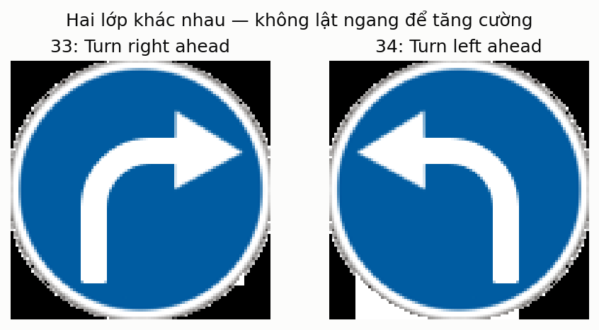

**Đây là hai ảnh Meta gốc của hai lớp khác nhau**, không phải cặp ảnh trước/sau
một phép lật đã được đưa vào train. Hướng mũi tên là thông tin xác định nhãn,
không phải nhiễu cần loại bỏ.

| ClassId và ý nghĩa gốc | Nếu lật ngang | Quyết định trong pipeline |
|---|---|---|
| 33: Turn right ahead — rẽ phải; 34: Turn left ahead — rẽ trái | Đổi ý nghĩa phải ↔ trái; giữ nhãn cũ sẽ tạo cặp ảnh–nhãn sai | Giữ riêng cả hai lớp, giữ hướng và ClassId gốc |
| 36: Go straight or right; 37: Go straight or left | Đổi đi thẳng hoặc phải ↔ đi thẳng hoặc trái | Không lật, không gộp lớp |
| 38: Keep right; 39: Keep left | Đổi đi về phía phải ↔ phía trái | Không lật, vẫn nạp và xử lý cả hai lớp |
| 19: Dangerous curve left; 20: Dangerous curve right | Đổi ý nghĩa cảnh báo cong trái ↔ cong phải | Không lật ảnh cảnh báo có hướng |

Các cặp trên minh họa **sự thay đổi ngữ nghĩa**, không khẳng định ảnh chụp sau khi
lật sẽ trùng từng pixel với ảnh của lớp đối diện. Lật dọc có thể làm mũi tên chỉ
xuống, đảo chữ hoặc tạo biển không hợp lệ; không có quy tắc bảo toàn nhãn chung
cho 43 lớp. Biển tốc độ và các hình bất đối xứng khác cũng không mặc nhiên an
toàn khi lật. Vì vậy, pipeline **không lật ngang hoặc dọc với bất kỳ lớp nào**,
không tự sinh mẫu đối xứng rồi gán lại nhãn.

**“Giữ lại” nghĩa là gì?** Giữ toàn bộ các ảnh thuộc lớp chỉ hướng trong train
và test chính thức, giữ nguyên nhãn và hướng trái/phải; vẫn crop ROI, resize và
chia 255 như các lớp khác. Không có nghĩa là bỏ bước tiền xử lý, giữ nguyên mọi
pixel, loại các lớp mũi tên khỏi dữ liệu hoặc chỉ giữ một hướng.

Ví dụ, lật ảnh lớp 33 nhưng vẫn gán nhãn 33 sẽ dạy mô hình rằng mũi tên trái là
“rẽ phải”. Điều cần tránh là **nhiễu nhãn do augmentation sai nghĩa**, không phải
một biến đổi chỉ làm ảnh kém đẹp. Báo cáo **không tuyên bố không lật làm Accuracy
tăng bao nhiêu**: chưa có thí nghiệm đối chứng có/không lật. Đây là ràng buộc
bảo toàn nhãn của bài toán, tách biệt với ba giả thuyết thực nghiệm ở mục 2.5.

### 3.3. Augmentation chỉ minh họa, không tự mở rộng tập dữ liệu

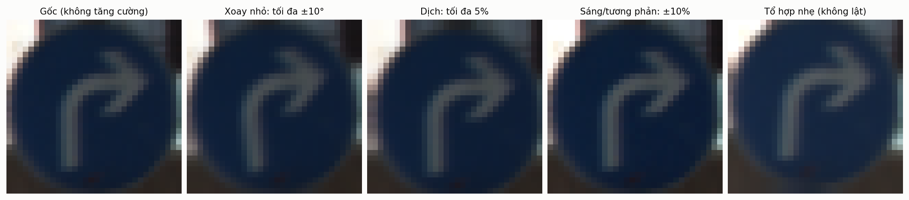

Hình cho thấy biến đổi nhẹ có thể mô phỏng góc chụp và ánh sáng mà vẫn giữ hướng
mũi tên trong ví dụ. `augment_image` mặc định `enabled=False`; pipeline và sáu
phương án ablation không gọi augmentation để tăng số mẫu. Nếu nghiên cứu tiếp,
chỉ áp dụng trong **train fold sau khi chia CV theo track**, không áp dụng cho
validation/test; ảnh gốc và biến thể của cùng ảnh phải ở cùng nhóm train.
Ngay cả phép biến đổi nhẹ cũng cần kiểm tra không làm mất chữ số/đầu mũi tên.
Chưa có kết quả đo cải thiện Accuracy/Macro-F1 nhờ augmentation.

### 3.4. Các trường hợp đặc biệt và cách xử lý

Bảng phân biệt **quan sát trên dữ liệu hiện có** với **nhánh phòng vệ đã có trong
code/test**. Nhánh phòng vệ không có nghĩa lỗi đó đã xuất hiện trong bộ dữ liệu.

| Trường hợp | Bằng chứng hoặc trạng thái | Xử lý và lý do |
|---|---|---|
| Thiếu `SignId` của ClassId 30 trong Meta | Có một NaN; đây không phải thiếu `ClassId` huấn luyện | Giữ lớp 30 và các ảnh; không tự điền `SignId` hoặc bỏ lớp. Pipeline đọc nhãn từ Train/Test, không dùng `SignId` làm target |
| Track `00033_00019` chỉ có 29 khung | Tổng train 39.209, không phải 39.210; các track còn lại có 30 khung | Giữ nguyên CSV; không tạo một ảnh bù, không gọi là lỗi đọc ảnh. Dùng `(ClassId, TrackId)` làm nhóm khi thiết kế CV |
| Lớp ít mẫu | Lớp 0, 19, 37 chỉ có 210 ảnh train mỗi lớp | Giữ tất cả lớp, không nhân bản/cắt giảm để cân bằng trong preprocessing; theo dõi Macro-F1 và recall từng lớp |
| Ảnh rất tối, rất sáng hoặc tương phản thấp | Mẫu chất lượng 2.000 train có các cực trị ở mục 2.2 | Giữ ảnh và nhãn; không loại mẫu khó để làm đẹp điểm, không tự thêm cân bằng sáng. Chia 255 không sửa phơi sáng |
| Ảnh mờ, nhỏ hoặc có tỉ lệ khác hình vuông | Biểu đồ kích thước và ví dụ ảnh cho thấy nguy cơ mất chi tiết; chưa có thống kê nhãn “mờ” toàn bộ tập | Resize thống nhất để có đầu vào cố định, ghi nhận mất nét/méo tỉ lệ; không khẳng định phóng to tạo thêm thông tin |
| Các biển tốc độ gần giống nhau | Mean image cho thấy cùng viền đỏ, khác chữ số | Giữ nhãn riêng; không gộp các mức tốc độ. Cần confusion matrix thật để xác định cặp nhầm nhiều |
| Biển chỉ hướng hoặc cảnh báo trái/phải | Khác ngữ nghĩa dù hình gần đối xứng; xem mục 3.2 | Giữ cả hai hướng và nhãn gốc; cấm lật toàn pipeline, không loại lớp |
| ROI vượt biên, đảo cận, không hữu hạn hoặc không giao ảnh | Nhánh phòng vệ trong `crop_roi`, có unit test bằng ảnh tổng hợp; chưa báo số trường hợp này trên toàn bộ dữ liệu | Kẹp ROI giao ảnh vào biên; ROI không hợp lệ thì dùng toàn ảnh. Dùng `+1` để giữ pixel X2/Y2. Không đồng nhất số lỗi ROI với số lỗi đọc ảnh |
| Ảnh thiếu/hỏng, Path thoát thư mục, nhãn không hợp lệ | Kiểm tra Path hiện không phát hiện thiếu; các lỗi này được mô phỏng trong tests | Dừng và nêu lỗi, không bỏ âm thầm, không thay bằng ảnh đen hay đoán nhãn |
| Đường dẫn có dấu trên Windows | Nhánh tương thích trong hàm đọc ảnh và kiểm thử | Đọc bytes rồi giải mã khi cần; tránh lỗi mở nhầm tên mã hóa, không đổi ảnh/nhãn để né lỗi đường dẫn |
| Thay bytes ảnh nhưng giữ CSV, hoặc cache/log không ghi được | Giới hạn cache và nhánh dự phòng của chương trình | Tạo lại cả cache pipeline và ablation khi thay ảnh; cache/log không ghi được chỉ cảnh báo nếu xử lý dữ liệu vẫn thành công. Cache hit không kiểm tra lại ảnh gốc |

Nguồn đối chiếu: [bảng tính toàn vẹn](tables/eda_integrity.csv),
[bảng mẫu chất lượng](tables/eda_quality_sample.csv),
[mã tiền xử lý](../src/preprocessing.py) và
[kiểm thử các nhánh đặc biệt](../src/tests/test_preprocessing.py).

## 4. Minh chứng tác động: ablation tiền xử lý

Nguồn: [02_preprocessing_ablation.ipynb](../notebooks/02_preprocessing_ablation.ipynb),
[CSV](tables/ablation_preprocessing.csv), [biểu đồ](figures/eda_ablation.png),
[summary](ablation_summary.json), [manifest](tables/ablation_sample_manifest.csv),
[dự đoán](tables/ablation_predictions.csv).

### 4.1. Thiết lập

- 8.000 train phân tầng theo lớp; 3.000 test ngẫu nhiên không hoàn lại, seed 42,
  **không phân tầng/cân bằng test**. Cùng danh sách/thứ tự ảnh cho mọi phương án.
- KNN k=3, uniform, Euclidean, brute, n_jobs=1; phép toán số giới hạn 2 luồng.
- Mốc: ROI=True, 32×32, RGB, AREA, chia 255. Mỗi phương án chỉ đổi một yếu tố
  so với mốc. Không scaler/PCA/augmentation, không thử tương tác nhiều yếu tố.
- Báo cáo Accuracy, Macro-F1 trên đủ 43 lớp, số chiều và fit+predict. Thời gian
  chuẩn bị/nén/nạp cache được đo riêng, không cộng vào thời gian mô hình.

### 4.2. Kết quả

| Phương án | Số chiều | Accuracy | Macro-F1 | ΔAccuracy so mốc (đpt) | ΔMacro-F1 so mốc (đpt) |
|---|---:|---:|---:|---:|---:|
| **ROI, 32×32, RGB, AREA (mốc)** | 3.072 | **47,67%** | **40,76%** | 0 | 0 |
| Không ROI, 32×32, RGB, AREA | 3.072 | 34,03% | 29,49% | −13,63 | −11,27 |
| ROI, 24×24, RGB, AREA | 1.728 | 48,00% | 40,84% | +0,33 | +0,08 |
| ROI, 48×48, RGB, AREA | 6.912 | 47,47% | 40,55% | −0,20 | −0,22 |
| ROI, 32×32, grayscale, AREA | 1.024 | 45,47% | 39,55% | −2,20 | −1,21 |
| ROI, 32×32, RGB, LINEAR | 3.072 | 47,37% | 40,60% | −0,30 | −0,17 |

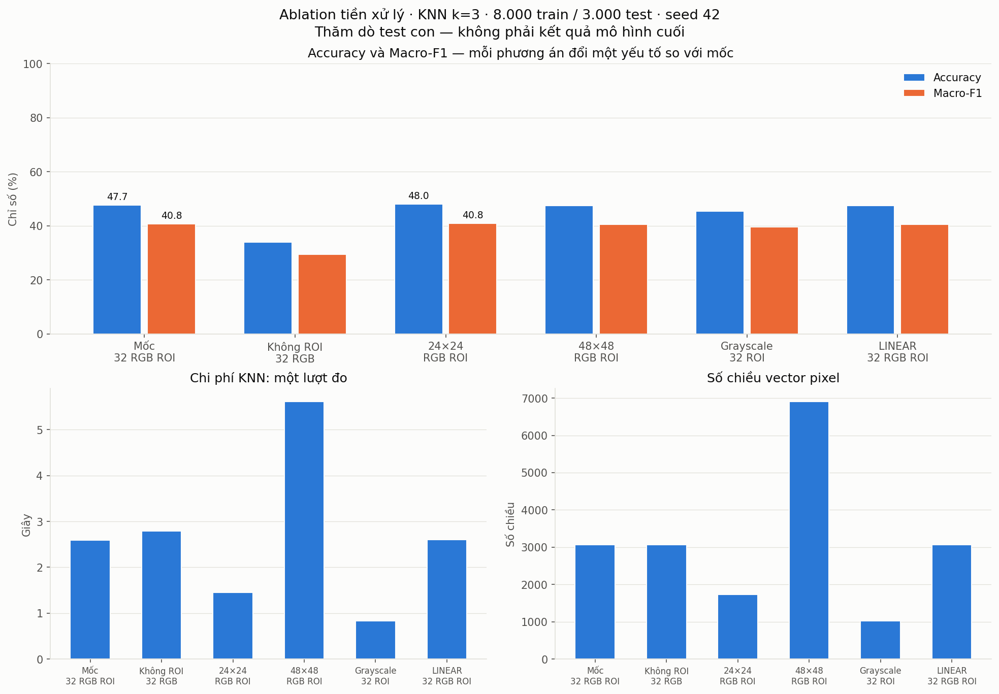

**Đọc hình:** mọi cột đều so với cùng mốc và cùng mẫu. Không ROI giảm điểm rõ
trong phép so sánh này; 24×24 nhỉnh hơn mốc rất ít, còn 48×48 tăng số chiều và
thời gian mà không cải thiện điểm. Grayscale giảm chi phí nhưng đồng thời giảm
điểm. Không chọn phương án chỉ vì một cột cao hơn khi chưa đánh giá độ bất định.
Biểu đồ thời gian và số chiều tách riêng để không trộn đơn vị.

Đọc thời gian fit+predict chính xác của lượt chạy đã lưu tại CSV/summary và
output notebook. Một lượt đo, không phải benchmark kiểm soát; không khẳng định
chênh lệch thời gian chỉ do tiền xử lý hay sẽ giữ nguyên trên máy khác.

### 4.3. Giải thích và quyết định bàn giao

1. **ROI có tác động lớn nhất trong các phép so sánh này:** tăng 13,63 đpt
   Accuracy / 11,27 đpt Macro-F1. Loại nền và căn vùng biển phù hợp với KNN pixel
   nhạy vị trí. Không suy rộng thành cam kết cho ảnh chưa được định vị.
2. **24×24 cao hơn mốc rất ít**, đồng thời giảm 43,75% số chiều. Làm mượt khi
   thu nhỏ có thể bớt nhiễu, nhưng mất nét chữ số. Không có kiểm định/multiple seed
   nên không kết luận +0,08 đpt Macro-F1 là ưu thế chắc chắn.
3. **48×48 không cải thiện trong mẫu này**, dù tăng số chiều 2,25 lần; phóng to
   không tái tạo chi tiết đã mất trong ảnh gốc, còn tăng chi phí khoảng cách.
4. **RGB tốt hơn grayscale trên mẫu này**, phù hợp thông tin màu nhóm biển.
   Hai biểu diễn khác cả số chiều/hình học khoảng cách, không chỉ màu.
5. **AREA nhỉnh hơn LINEAR rất ít**; AREA có cơ sở khi thu nhỏ nhưng số liệu
   không chứng minh tối ưu cho mọi ảnh, đặc biệt những ROI phải phóng to.

**Cấu hình tích hợp giữ nguyên: ROI=True, 32×32, RGB, INTER_AREA, float32/255.**
Đây là cấu hình đã thống nhất cho nhóm và bảo toàn hợp đồng HOG/RGB, không phải
cấu hình được chứng minh tối ưu toàn cục. **Đề xuất kiểm chứng 24×24 bằng CV theo
track trên train**, rồi nhóm mới quyết định có đổi biểu diễn/hợp đồng hay không.
Không tự ý sửa `config.py` theo điểm test.

### 4.4. Trung thực và hạn chế đánh giá

- Cả EDA và ablation đã xem các test con. Đây là thăm dò theo yêu cầu bài tập,
  **không phải đánh giá cuối cùng trên holdout hoàn toàn mù**.
- Không so trực tiếp điểm EDA 5.000/2.000 với ablation 8.000/3.000 để khẳng định
  một kỹ thuật tốt hơn: khác cỡ mẫu và cách lấy test.
- Không dùng test để tiếp tục tuning. CV theo track trên train giúp xác nhận
  lựa chọn nhưng không làm cho test đã xem trở thành chưa từng được xem.
- Một seed, một k cố định, một lượt timing, không khoảng tin cậy/kiểm định;
  ảnh trong cùng track không phải quan sát độc lập hoàn toàn.
- Chỉ kiểm tra Path, chưa hash toàn bộ ảnh để phát hiện trùng nội dung. Resize
  vuông có thể méo tỉ lệ, không xử lý mờ/ánh sáng/biển bị che khuất.

## 5. Tái lập, log và minh bạch AI

- Python thực nghiệm **3.13.2, Windows 11**; requirements ghim các phiên bản đã
  cài. Bộ pin hiện tại cần Python ≥3.12 do SciPy. Môi trường thực nghiệm kế thừa
  một số package hệ thống; chưa tuyên bố đã kiểm thử cài mới sạch trên mọi OS.
- [Script kiểm tra](../scripts/verify_data_prep.py) chạy tuần tự: pip freeze/check,
  unit tests, CLI tiền xử lý, hai notebook, smoke-test main. Kernel dùng đúng
  interpreter gọi script. Có thể chạy từ gốc bằng:

  ```powershell
  .\venv\Scripts\python.exe scripts/verify_data_prep.py
  ```

- [logs/preprocessing.log](../logs/preprocessing.log) ghi timestamp, seed, config,
  cache hit/miss/disabled, counts, X/y metadata, min/max, lỗi/bỏ qua và thời gian.
  Khi cache hit, `errors=0` là không có lỗi trong lượt nạp cache, **không** là
  khẳng định đã giải mã/kiểm tra lại mọi ảnh gốc.
- Tests dùng ảnh tổng hợp và thư mục tạm, không yêu cầu dữ liệu thật, không ghi
  nhiễu vào log dữ liệu thật. Lỗi log chỉ cảnh báo, lỗi ảnh vẫn fail-fast.
- Cache toàn bộ và cache ablation nằm trong `data/`, bị Git ignore. Các hình
  tổng hợp báo cáo và log được bàn giao; không stage ảnh gốc, cache hay venv.
- Smoke-test chỉ xác nhận `main.py` nạp dữ liệu và tới đầu `build_features` rồi
  **chủ động dừng**, chưa chạy xong feature extraction/GridSearchCV/đánh giá đầy đủ.
- Xem [AI_USAGE.md](../AI_USAGE.md) để biết mức hỗ trợ AI, gồm phần bổ sung diễn
  giải báo cáo này. Phần người học tự kiểm tra/sửa **chưa khai báo**; không coi
  log do AI chạy là đã tự kiểm chứng. Thư mục `docs/prompts/` không còn trong
  workspace ở lần cập nhật 2026-11-12; nếu rubric yêu cầu lưu prompt, cần khôi
  phục bản nguyên văn trước khi bàn giao, không coi log cũ là bằng chứng các
  file đó vẫn hiện diện.

### 5.1. Bằng chứng kiểm tra ngày 2026-11-11

Các số liệu dưới đây mô tả lượt kiểm tra đã lưu trước khi bổ sung báo cáo,
không phải thông báo đã chạy lại pipeline ngày 2026-11-12. Trạng thái file
prompt ở thời điểm đó khác workspace hiện tại như lưu ý phía trên.

- **24/24 unit tests đạt**, gồm 14 kiểm thử cũ và 10 kiểm thử mới cho tùy chọn
  resize/default equality/logging. Lượt tích hợp cuối: 1,892 giây cho tests.
- CLI tiền xử lý nạp cache toàn bộ dữ liệu, đúng hợp đồng; thời gian loader
  4,403 giây, `errors=0 skipped=0` trong lượt nạp cache.
- EDA **9/9 ô code, 0 lỗi**, 93,43 giây. Ablation **6/6 ô code, 0 lỗi**,
  37,22 giây khi đủ cache; lần đầu chưa có cache 394,23 giây (khoảng 6,57 phút).
  Thời gian phụ thuộc I/O, CPU, kernel startup và cache của hệ điều hành.
- Fit+predict của lượt ablation cuối: mốc **2,587s**, không ROI **2,795s**,
  24×24 **1,456s**, 48×48 **5,618s**, grayscale **0,831s**, LINEAR **2,607s**.
  Các chỉ số Accuracy/Macro-F1 giống lượt chưa có cache; timing thay đổi giữa lượt.
- Kiểm tra độc lập: toàn bộ **11.000 ảnh mốc ablation khớp từng pixel với cache
  pipeline trước bổ sung**; nhãn/thứ tự mẫu khớp CSV; tính lại metric từ file dự
  đoán khớp bảng. Không chỉ kiểm tra shape của vài ảnh.
- **12 PNG, 150 dpi; 20 CSV** (16 EDA + 4 ablation). Hai prompt khớp nguyên văn,
  các pin package khớp môi trường, `pip check` không báo dependency hỏng.
- Main tới `build_features` trong 14,16 giây rồi bị chủ động dừng; exit=1 của
  tiến trình con trên Windows là do dừng bằng taskkill, không phải một lượt
  huấn luyện hoàn tất. Script kiểm tra tổng kết `status=passed` cho đúng phạm vi.
- Jupyter có cảnh báo transport TCP không mã hóa trong lượt chạy local; không
  có lỗi ô code. Không mở kernel ra mạng hoặc dùng chung máy/mạng không tin cậy
  mà chưa cấu hình bảo vệ phù hợp.
- Bằng chứng máy đọc được: [logs/verification.json](../logs/verification.json).
  Không stage/commit/push; các mô-đun `features.py`, `models.py`, `evaluate.py`
  và `main.py` không thay đổi.

