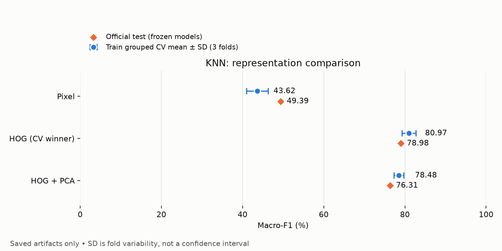

# Nguyễn Hoàng (Người 3) — K-NN theo track, kết quả và giới hạn

## Kết luận từ run đã hoàn tất

Full tune `full-knn-01` và official test `20261113T194939Z-test-adf82d0d` **đã hoàn tất**, thay cho trạng thái chưa chạy trong nhật ký triển khai bên dưới. Lần tổng hợp này chỉ đọc JSON/CSV/predictions đã lưu, không retrain, không dự đoán lại, không đổi cấu hình hoặc chọn theo test. Winner khóa bằng CV là **HOG + StandardScaler + KNN(k=7, distance, Manhattan)**.

### Bảng kết quả chính

Điểm dưới đây ở thang 0–1; CV là mean ± population std của ba fold, không phải khoảng tin cậy. Accuracy là tỷ lệ ảnh đúng; các chỉ số macro lấy trung bình đều 43 lớp, `zero_division=0`.

| Biểu diễn | k / weights / metric | Chiều refit | CV Accuracy ± std | CV macro-F1 ± std | Test Accuracy | Test Precision macro | Test Recall macro | Test F1 macro | Sai / 12.630 |
| --- | --- | ---: | ---: | ---: | ---: | ---: | ---: | ---: | ---: |
| Pixel | 3 / distance / euclidean | 3072 | 0,501049 ± 0,009003 | 0,436182 ± 0,026912 | 0,557245 | 0,513669 | 0,490561 | 0,493948 | 5.592 |
| HOG (winner CV) | 7 / distance / manhattan | 324 | 0,822310 ± 0,006224 | 0,809718 ± 0,016981 | 0,818369 | 0,813760 | 0,777906 | 0,789750 | 2.294 |
| HOG+PCA | 7 / distance / euclidean | 107 | 0,805172 ± 0,003694 | 0,784772 ± 0,011893 | 0,796675 | 0,792526 | 0,747460 | 0,763063 | 2.568 |

- HOG hơn Pixel **26,1124 điểm phần trăm Accuracy** và **29,5803 điểm macro-F1** trên test. Đây là so sánh các pipeline đã tune riêng, không cô lập tác động của chỉ một biến.
- HOG+PCA giảm 324 → 107 chiều (66,98%), nhưng kém HOG 2,1694 điểm Accuracy và 2,6687 điểm macro-F1 test. PCA giữ phương sai không bảo đảm giữ thông tin phân lớp. Không chuyển winner sang PCA vì tốc độ hoặc điểm test.
- HOG test macro-F1 thấp hơn CV mean 1,9968 điểm; Pixel test cao hơn CV mean không chứng minh rò rỉ hay tính vượt trội. Train-track CV và official test có phân phối/cách chia khác nhau.
- Bảng đầy đủ Precision/Recall/F1/Accuracy mean/std và cấu hình: [knn_summary.csv](tables/knn_summary.csv). Đủ **36 candidates (12 mỗi biểu diễn)**, split scores và dimensions: [knn_candidates.csv](tables/knn_candidates.csv). Giá trị `test` trong tên cột CV của sklearn nghĩa là validation fold, không phải official Test.csv.



Hình được tạo lại từ bảng đã lưu, không chạy lại mô hình. Bảng CSV là bản số liệu tương đương để đọc chính xác.

### Chi phí thực đo

| Pipeline | Grid CV + refit (s) | Refit riêng (s, đã nằm trong cột trước) | Predict + tính metrics test (s) | ms/ảnh test (trung bình theo batch, gồm metrics) |
| --- | ---: | ---: | ---: | ---: |
| Pixel | 21642,751 | 0,120 | 133,769 | 10,591 |
| HOG | 2174,799 | 0,252 | 104,088 | 8,241 |
| HOG+PCA | 692,199 | 0,485 | 6,609 | 0,523 |

Nguồn: [knn_timings.csv](tables/knn_timings.csv), [timings.json](knn/full-knn-01/timings.json), [test_metrics.json](knn/20261113T194939Z-test-adf82d0d/test_metrics.json).

Đọc/decode/ROI/resize train **714,510 s**; HOG train tính chung **33,638 s một lần**, dù trường `feature_seconds` được lặp ở hai phương pháp. Test load **255,363 s**; HOG test **10,358 s một lần**, HOG+PCA tái dùng HOG nên feature time gần 0 **không có nghĩa PCA miễn phí**. Trường lịch sử `predict_seconds` bao gồm dự đoán theo batch, scaler/PCA trong pipeline, kiểm tra nhãn và tính Accuracy/Precision/Recall/F1; không phải thời gian predict thuần. Không gồm load ảnh, trích HOG hay load bundle. Refit nằm trong search+refit, không cộng lần nữa. Các khoảng này không phải wall-time toàn lệnh (còn I/O ghi model/bảng, kiểm tra metadata/hash). So sánh dùng cấu hình tốt nhất riêng (metric khác nhau), không phải benchmark thuần giảm chiều; ms/ảnh là throughput batch, không phải latency realtime đơn ảnh. KNN refit nhanh vì chủ yếu lưu vector, phần nặng là tra cứu khoảng cách lúc predict; Pixel grid mất khoảng 6,01 giờ.

### Trường hợp đặc biệt quan sát được

Tính từ **predictions đã lưu**, không xem ảnh để suy đoán nguyên nhân. [Thống kê 43 lớp × 3 model](tables/knn_class_summary.csv), [cặp nhầm có hướng](tables/knn_error_pairs.csv). Đây chỉ là tóm tắt KNN, không thay confusion matrix/phân tích lỗi đầy đủ của người 4.

| ClassId (HOG winner) | Số test | Đúng | Recall |
| --- | ---: | ---: | ---: |
| 30 | 150 | 37 | 0,246667 |
| 0 | 60 | 22 | 0,366667 |
| 27 | 60 | 24 | 0,400000 |
| 41 | 60 | 24 | 0,400000 |
| 21 | 90 | 49 | 0,544444 |

Các cặp sai thường gặp của HOG: **1→5:119**, **1→2:93**, **2→5:81**, **7→8:65** ảnh. Cặp có hướng, không cộng ngược chiều. Lớp 1 có 720 mẫu nhưng recall chỉ 445/720 = 0,618056; support lớn không bảo đảm nhận dạng tốt. Accuracy HOG 81,84% trong khi recall macro 77,79% cho thấy điểm tổng thể che khuất lớp yếu; không suy ra ảnh mờ, thiếu sáng, khuất hay lỗi crop chỉ từ ClassId. Lớp support 60 nhạy với vài ảnh sai hơn lớp đông mẫu; chưa tính uncertainty theo lớp.

Trường hợp vận hành: tên track sai/nhãn lệch bị chặn, không fallback random image split; dataset có cả `data/` và `data/archive/` phải chỉ định; selection smoke không được test; claim test đã tồn tại thì dừng, không tự resume/xóa; lỗi ảnh fail-fast; thiếu tqdm chỉ ghi version null và không bắt buộc cài. Preflight không decode ảnh nên không chứng minh toàn bộ ảnh hợp lệ; full load thực tế báo errors=0/skipped=0 trong log nguồn.

### Hạn chế và tính trung thực của đánh giá

1. Chỉ **một seed 42, ba fold**, 12 candidates/biểu diễn trong grid hẹp k={3,5,7}, weights={uniform,distance}, metric={euclidean,manhattan}. Không repeated/nested CV, chưa có CI/kiểm định ý nghĩa; điểm CV dùng chọn best có selection bias.
2. Theo nhóm `(ClassId,TrackId)` giảm rò rỉ frame cùng track giữa train/validation; không chứng minh độc lập nội dung ảnh. SHA256 là CSV/model, **không hash nội dung toàn bộ ảnh**, không loại trừ near-duplicate giữa official split.
3. Test đã được EDA/ablation thăm dò trước đó. Ba pipeline được khóa trước lần test này; không gọi test là tập hoàn toàn chưa từng xem, không dùng kết quả này để tuning thêm.
4. HOG không học đặc trưng semantic; KNN nhạy biểu diễn, scale, khoảng cách, mất cân bằng lớp và dữ liệu ngoài phân phối. Đây là giới hạn phương pháp, chưa phải nguyên nhân lỗi ảnh đã được xác minh. Chỉ phân loại biển đã định vị, chưa detection toàn cảnh, chưa benchmark ngoài GTSRB.
5. Brute-force lưu vector train nên bundle lớn, dự đoán tốn chi phí tăng theo số train × số query × chiều; batching giảm peak memory chứ không bỏ chi phí khoảng cách. Chưa đo peak RAM/bundle size hay latency triển khai thực tế; không tuyên bố realtime.
6. PCA 95% fit riêng fold-train. Full run này các fold và refit đều ra **107**, nhưng smoke là **103/102/101**; 107 không phải hằng số cấu hình. PCA có thể bỏ chiều ít phương sai nhưng có ích cho nhãn.
7. Môi trường thực chạy lệch vài pin requirements (xem nhật ký bên dưới); giữ nguyên phần người 1/2. Một test float32 của người 2 vẫn fail; không sửa tolerance để làm đẹp báo cáo.

### Tái tạo báo cáo và lưu bằng chứng

```powershell
# Từ root repo; chỉ đọc artifact, không train/test/inference:
& ./.venv/Scripts/python.exe scripts/summarize_knn.py
# Run khác đã hoàn tất có thể truyền --tune-dir và --test-dir.
$env:PYTHONIOENCODING = "utf-8"
& ./.venv/Scripts/python.exe -m unittest src.tests.test_models src.tests.test_knn_summary -v
```

Exporter kiểm tra selection hash/claim, cấu hình best, row alignment và tính lại metrics **từ nhãn/prediction có sẵn** với sai số 1e-12. Chỉ ghi đè output tên `knn_*`, không sửa run gốc/model. Nguồn + SHA256 và định nghĩa timing: [knn_export_provenance.json](../logs/knn/knn_export_provenance.json); [log export](../logs/knn/knn_export.log). Loader log gốc được sao chép nguyên vào [logs/knn](../logs/knn/), giữ bản trong run. Lượt CLI tương lai ghi loader log trực tiếp `logs/knn/<run-id>/preprocessing.log`; bảng CV/predictions gốc vẫn ở run để giữ provenance, helper xuất bản tổng hợp dưới `report/tables` và hình dưới `report/figures`.

**Không sao chép được console full training/testing lịch sử từ thư mục tạm:** thao tác bị hệ thống quyền từ chối. Không tạo console giả từ JSON, không chạy lại test để có log. Bản loader log có sẵn được lưu dưới logs; log xuất bảng và kiểm thử là lượt thực thi mới. Console lịch sử có encoding legacy/mixed và các escape tiếng Việt; không khẳng định đã sửa Unicode hay khôi phục mất mát.

Xác minh hiện tại: **12/12 focused tests pass** (9 modeling + 3 exporter/logging), full suite **49/50 pass**, còn đúng lỗi `test_features.py:149`, float32 chênh `5.9604645e-08` ở cumulative variance. [Focused log](../logs/knn/knn_focused_tests.log), [full suite log](../logs/knn/knn_full_suite.log). Đây là kiểm thử do trợ lý chạy, không chứng minh Nguyễn Hoàng đã tự đọc/giải thích toàn bộ code.

---

## Nhật ký triển khai ban đầu (lịch sử, trước full tune/test)

## Phạm vi

Bổ sung `src/models.py`, entry point `scripts/train_knn.py`, tests `src/tests/test_models.py` và tài liệu này. Không thay đổi preprocessing/features/config/evaluate/main, requirements, notebook, legacy `train_and_tune` hoặc Decision Tree. Không di chuyển dữ liệu; không ghi `report/summary_results.csv` hoặc output EDA/ablation. Không commit/push.

## Cách chạy (PowerShell, từ root repo)

Dùng Python của `.venv`, không dùng Python mặc định của Anaconda:

```powershell
& ./.venv/Scripts/python.exe -m unittest discover -s src/tests -v
& ./.venv/Scripts/python.exe scripts/train_knn.py preflight --dataset-dir data
& ./.venv/Scripts/python.exe scripts/train_knn.py smoke --dataset-dir data --batch-size 128
# Chạy sau khi cân nhắc chi phí; chưa thực hiện full tune trong đợt triển khai:
& ./.venv/Scripts/python.exe scripts/train_knn.py tune --dataset-dir data --run-id full-knn-01 --batch-size 128
# Chỉ sau khi full tune hoàn tất, selection.json có status=frozen:
& ./.venv/Scripts/python.exe scripts/train_knn.py test --dataset-dir data --selection report/knn/full-knn-01/selection.json
```

Không chỉ định `--dataset-dir`: tự nhận `data/` hoặc `data/archive/` khi chỉ một layout chứa Train.csv/Test.csv/Meta.csv; hai layout cùng tồn tại phải chỉ định. `main.py` cũ vẫn giữ cấu hình archive. CLI có thể gọi từ nơi khác; output luôn neo theo root repo. `--run-id` phải mới, không dùng lại thư mục cũ.

## Giao thức

- `preflight`: kiểm tra metadata train, Path nằm trong dataset root và tồn tại, 43 lớp, tên file khớp ClassId/thư mục. Không decode ảnh và không mở Test.csv; chỉ xác nhận các CSV của layout có tồn tại.
- `(ClassId, TrackId)` lấy từ tên `class_track_frame.png`; giữ thứ tự CSV và đối chiếu nhãn loader. Không fallback sang random image split khi parse sai.
- Dùng chung `StratifiedGroupKFold(3, shuffle=True, random_state=42)` cho pixel/HOG/HOG+PCA. Assert không giao nhóm, mỗi phía đủ 43 lớp và mỗi ảnh validation đúng một lần. Manifest có CSVRow (0-based), Path, ClassId, Group, ValidationFold; thống kê ảnh/track theo lớp lưu riêng.
- Tiền tính chỉ pixel/HOG stateless từ hàm public người 2. Pixel giữ nguyên RGB /255, 3072 chiều. HOG 324 chiều + StandardScaler; HOG+PCA thêm PCA 95%, cast float32 tương đương người 2. Scaler/PCA nằm trong Pipeline và chỉ fit fold-train; PCA dimensions lưu riêng cho từng fold và full refit, không cố định 107.
- Mỗi biểu diễn: k={3,5,7}, weights={uniform,distance}, metric={euclidean,manhattan}, brute force. 12 candidates × 3 folds × 3 methods =108 CV fits, cộng ba full-train refit. `GridSearchCV` multi-metric, lỗi raise, một lần dự đoán theo batch/candidate/fold cho Accuracy và macro Precision/Recall/F1 trên labels 0..42, zero_division=0. Best theo mean macro-F1; tie lấy candidate đầu theo `ParameterGrid`, sau đó thứ tự pixel/hog/hog_pca. Không dùng timing hay test để chọn.
- `smoke`: seed 42 chọn nguyên 3 track mỗi lớp từ official train (mặc định 129 track, 3.870 ảnh), k=3/uniform/euclidean duy nhất, 9 CV fits + ba smoke refit. Selection `smoke_only` không được bước test chấp nhận. Điểm smoke không phải kết quả chính thức hoặc dự báo full train.
- `tune`: luôn nạp toàn bộ train bằng public `load_split`; không lấy mẫu ngầm. Khóa ba cấu hình và winner trước test. Chỉ ghi selection cuối cùng khi cả ba model đã lưu xong. SHA256 metadata train và từng bundle, version/seed/contract được lưu. Fingerprint là metadata/model, không phải hash toàn bộ nội dung ảnh; nếu ảnh đổi mà CSV giữ nguyên, fingerprint không phát hiện.
- `test`: yêu cầu selection full-train tương thích dataset, ba method, số train; kiểm tra hash bundle. Test chính thức chỉ dùng inference, không fit/chọn lại. Xuất một prediction/CSV row cho từng model đã chốt và Accuracy, Precision/Recall/F1 macro. Test từng được EDA thăm dò một phần: không mô tả là hoàn toàn chưa từng xem.
- File `official_test_claim.json` tạo độc quyền trong tune run trước khi mở test để chống vô tình test lặp. Nếu test lỗi giữa chừng, claim vẫn tồn tại (fail closed); cần điều tra nguyên nhân và quyết định phục hồi có chủ ý, không chạy lại mù quáng. Không hỗ trợ resume tự động.
- `n_jobs=1`, numeric threads=2, predict batch mặc định 128. Không tạo distance matrix toàn bộ train×test. Bundle joblib chứa train vectors nên lớn; chỉ load file tin cậy (pickle có thể chạy code). Hash không biến file từ nguồn không tin cậy thành an toàn.

## Output và bàn giao người 4

- Nhẹ: `report/knn/<run-id>/config.json`, `fold_manifest.csv`, `fold_statistics.json`, `cv_<method>.csv` (đủ split scores, mean/std, timings và dimensions), `selection.json`, `timings.json`.
- Lớn: `data/models/knn/<run-id>/<method>.joblib` (đường dẫn đã ignore). Bundle gồm Pipeline, class names/order, raw dimensions, image/HOG contract, seed, metadata/version.
- Test run mới: `test_metrics.json` và `predictions_<method>.csv` gồm CSVRow/Path/ClassId/PredictedClassId. Không tự viết confusion matrix/phân tích lỗi thay người 4.
- `load_split` dùng handler logger public trỏ vào run mới; không monkeypatch module preprocessing, không ghi đè log cũ. Tests cũ tự dùng fixture tạm.

## Xác minh triển khai 2026-11-13

Preflight thành công ở `report/knn/implementation-preflight-20261113-v2/`: 39.209 train, 43 lớp, 1.307 track, ba fold hợp lệ. Không đọc official test.

Smoke thành công ở `report/knn/implementation-smoke-20261113/`: 3.870 ảnh, đủ 43 lớp, 129 nguyên track, 9 CV fits + 3 refit; không đọc/score official test, không chạy DT. Thời gian đo:

| Bước | Giây |
| --- | ---: |
| Đọc/decode smoke train | 77,957 |
| HOG dùng chung | 3,658 |
| Pixel CV + refit | 3,855 |
| HOG CV + refit | 0,636 |
| HOG+PCA CV + refit | 0,828 |

Smoke macro-F1: pixel 0,159832; HOG 0,563831; HOG+PCA 0,568246. HOG+PCA dimensions từng validation fold: 103/102/101. Không suy diễn ETA full grid từ smoke: cặp khoảng cách tăng gần bậc hai theo số ảnh, Manhattan 3072 chiều có thể tốn hơn nhiều, I/O cold/cache cũng khác. Chưa chạy full108 CV hoặc official test.

Môi trường `.venv`: Python 3.13.2; sklearn 1.9.1; scikit-image 0.26.0; OpenCV 5.0.0.93; joblib 1.6.0; scipy 1.18.1. Khác requirements: numpy 2.5.4 thay 2.2.4; pandas 3.1.1 thay 2.3.3; threadpoolctl 3.8.0 thay 3.7.0; thiếu tqdm 4.70.1 (loader hỗ trợ optional). Không tự cài hoặc sửa pin. Python mặc định Anaconda 3.14.6 thiếu distribution opencv-python, không dùng để chạy.

Lượt suite đầu từ đúng repo root: 46 tests, 45 pass, 1 fail có sẵn ở `src/tests/test_features.py:149`: float32 cumulative PCA vs sum chênh 5,9604645e-08 nhưng assertAlmostEqual 7 places thất bại. Giữ nguyên test/source người 2. Sau đó bổ sung test chặn smoke selection trước khi đọc test: suite cuối 47 tests, 46 pass và cùng 1 fail float32 đó (1,575 giây). Chạy riêng 9 tests người 3: tất cả pass (0,545 giây). `git diff --check` sạch; git status xác nhận chỉ models.py là tracked file sửa, ba file mới và report/knn mới; bundles được ignore. Lệnh test ban đầu từ cwd cha thất bại import `src`; đã sửa cách chạy từ root, không sửa module/path thành viên khác.

Preflight đầu cũng phát hiện thiếu tqdm khi ghi versions; CLI đã xử lý version optional là null. Giữ nguyên thư mục run dở `implementation-preflight-20261113` thay vì ghi đè/xóa. Run v2 và smoke mới hoàn tất đúng giao thức.
